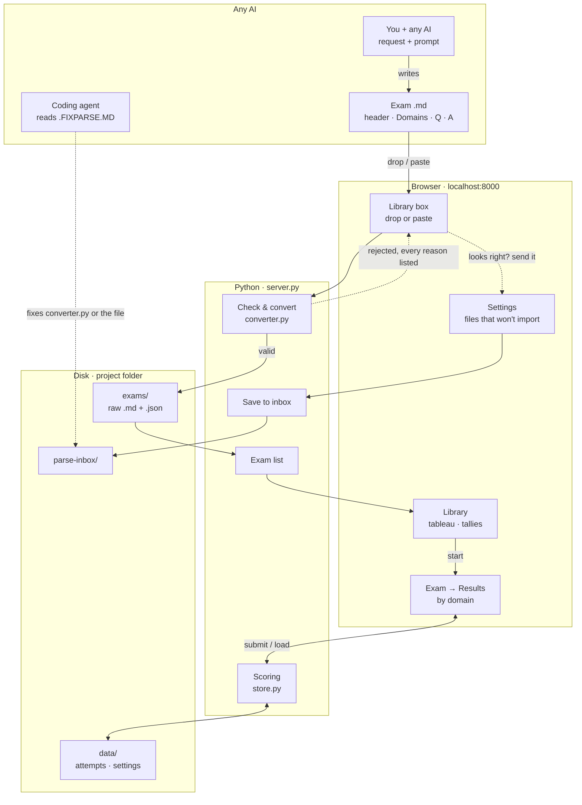

# Localhost Exam Simulator

Practise certification exams on your own machine, in conditions close to the real exam. Any AI writes the exam, and you get your score broken down by domain.

## How to

**Run it.** To run the web app, pipe the contents of `run.txt` into your shell:

```
cd localhost-exam-simulator && cat run.txt | sh
```

Then open http://localhost:8000. Stop it with `Ctrl+C`. Python 3.9+ is all you need: no installs, no build step, and it works offline.

**Get an exam.**
1. In the library, press **Copy** on the `prompt-for-exam.md` block.
2. Ask any AI for an exam and paste the prompt with your request, e.g. *"GCP ADP, extra difficult, at least one very close distractor per question. Follow this prompt-for-exam.md for the exact output file structure."*
3. Import the reply: drop the saved `.md` file onto the library box, or switch it to **Paste** and paste the text. The file name doesn't matter. The header at the top of the exam decides what it is and which column it goes in. To try it first, use `samples/questions-and-answers-sample-demo-1.md`.

**Take it.** Pick the exam in the library and press **Start** (later **Retake**).
- Answer with a click, A–D or 1–4. Move between questions with ←/→.
- ★ bookmarks a question. The box under it holds your note.
- **Review** lists every question with its bookmark, note and status. Click a row to jump to it.
- The timer is green while time is left, then turns red and counts overtime. It never submits for you.
- **Pause** works, but warns you that real exams don't have one.
- **Submit** asks once, then shows your results.

**Read your results.** You get the score, the time, whether you paused, and a bar per domain (red below your pass mark). Every question follows, with the right answer, your answer, the explanation and your note. Flip **Revised** once you've gone through it.

**Settings** (⚙ in the library):
- Light or dark, and classic (looks like a test-centre client) or modern
- The pass mark
- Change an exam's time, or delete it

**When a file won't import.** The library lists every reason. If the file looks right to you anyway:
1. Open **Settings → Files that won't import**, then drop the file or paste the text. It's saved as `parse-inbox/inbox-001.md`, `inbox-002.md`, and so on.
2. Start any coding agent in this folder and give it the line shown there, which has a **Copy** button: *"Read .FIXPARSE.MD in this folder and fix the files waiting in the parse inbox."*
3. Fixed files end up in `parse-inbox/ready/`. Import them from the library.

**Check a file without importing it:** `python3 converter.py <file.md>`

**Run the tests:** `python3 -m unittest discover tests`

**Change the code.** Make one concern per commit, keep the tests green, and never rewrite history. `git log --reverse` replays how the project was built, module by module.

## How it works

### Four layers
Only the Python layer touches the disk. An exam is either saved completely or rejected with nothing written. Attempts are saved once, when you submit.



### The exam file
Your message to the AI sets the content and difficulty, and `prompt-for-exam.md` fixes the structure. Every answer names its domain, which is what drives the per-domain score.

```markdown
---
exam_maker: gcp
exam_name: adp
exam_number: 1
title: GCP Associate Data Practitioner – Practice 1
duration_minutes: 120
domain_count: 3
---

# Domains
- D1: Data Preparation and Ingestion
- D2: Data Analysis and Presentation
- D3: Data Management

# Questions
## Q1
A team loads daily CSV exports into BigQuery…
- A) …
- B) …
- C) …
- D) …

# Answers
## Q1
Answer: C
Domain: D1
Explanation: Why C is right, and why A, B and D are wrong.
```

- **The header is the exam's identity.** The ID is `exam_maker-exam_name-exam_number`, ignoring case and hyphens, so `AI-Engineer` and `aiengineer` are the same exam name. The same maker and name put exams in the same column, and the number tells them apart. Importing the same ID twice is refused, never overwritten.
- **The parser is strict on purpose.** It reports every problem at once instead of guessing. It does accept common AI habits: a filename line and a code fence around a pasted reply, Windows line endings, **bold** labels, and `A.` / `(A)` choice styles. A choice-like line inside a code block is not mistaken for a choice.

### The library
- **Tableau view:** exams with the same maker and name form a column, like a solitaire tableau. Cards cascade so each shows its top strip, and the last one shows in full. **List view** shows every exam as its own card.
- **Search:** plain text matches anywhere in the ID or title. Wrap it in slashes for a regex, the way grep works: `/gcp-.*-1/`.
- **Tally marks:** one stroke per attempt, grouped in fives. At most one stroke is green, for the attempt that meets all three rules: it is the highest score on that exam, it is at or above the pass mark, and it was neither paused nor overtime. If your best score was paused, nothing turns green until you beat it cleanly.
- **History:** selecting an exam shows every attempt (date, score, time, continuous, revised). Click a row to reopen its results.

### Taking the exam
- **Layered review panel:** with a note open, the first click elsewhere only closes the note. With no note open, a click outside the panel closes it. `Esc` closes whatever is on top.
- **Notes column:** the first three words of a note show in the review list. Click them to read the whole note.
- **Leaving mid-exam:** you're asked first, because an unsubmitted attempt is discarded.

### Settings
- **Four looks:** light or dark × classic or modern. Only colours and styling change; the layout is identical, so the real exam still feels familiar.
- **Time changes** only affect new attempts. Each attempt remembers the time limit it was taken with.

### Files
| Path | What it is |
|---|---|
| `run.txt` | The one command that starts the app |
| `prompt-for-exam.md` | The format spec you give to the exam-writing AI |
| `.FIXPARSE.MD` | Instructions for any coding agent fixing files in the parse inbox |
| `converter.py` | Parses and validates exam markdown |
| `store.py` | Storage, scoring, domain scores, the green-tally rule, the parse inbox |
| `server.py` | Local HTTP server and JSON API (127.0.0.1 only) |
| `web/` | The single-page app: `js/library.js`, `exam.js`, `results.js`, `settings.js` |
| `samples/`, `tests/` | Example exams (good and broken) and the unit tests |
| `reproduciable-plan-prompt-for-localhostexamsimulatorparser.md` | The original design, frozen, to hand to other builders |
| `exams/`, `data/`, `parse-inbox/` | Your exams, attempts, settings and rejected files (not tracked by git) |
