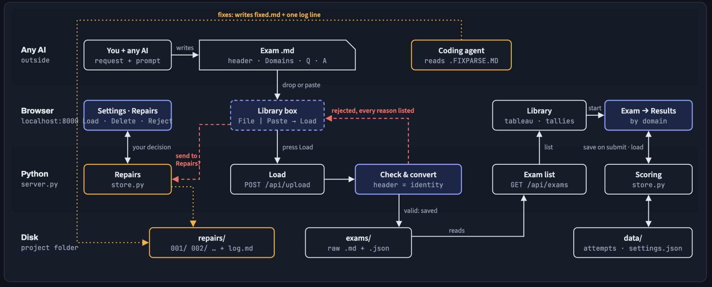
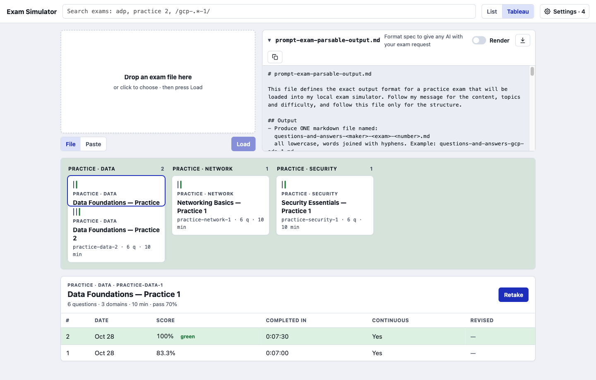
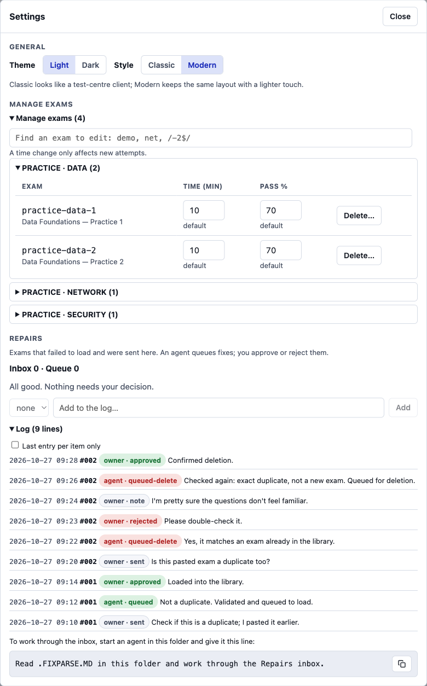
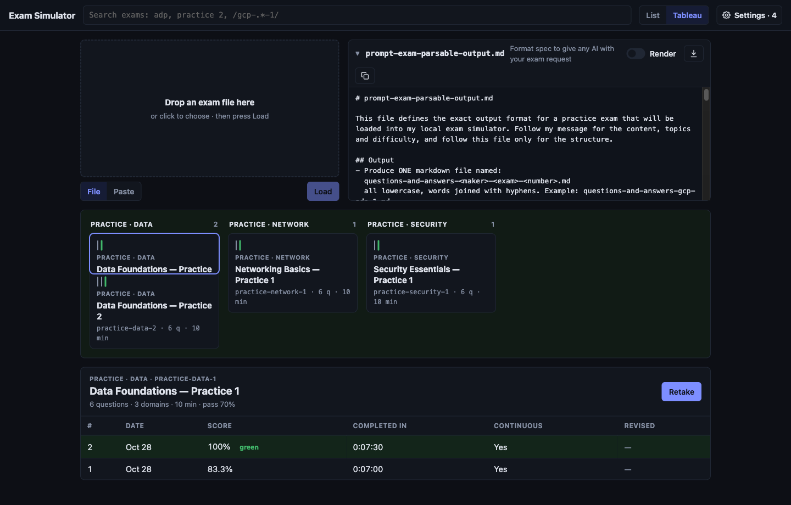
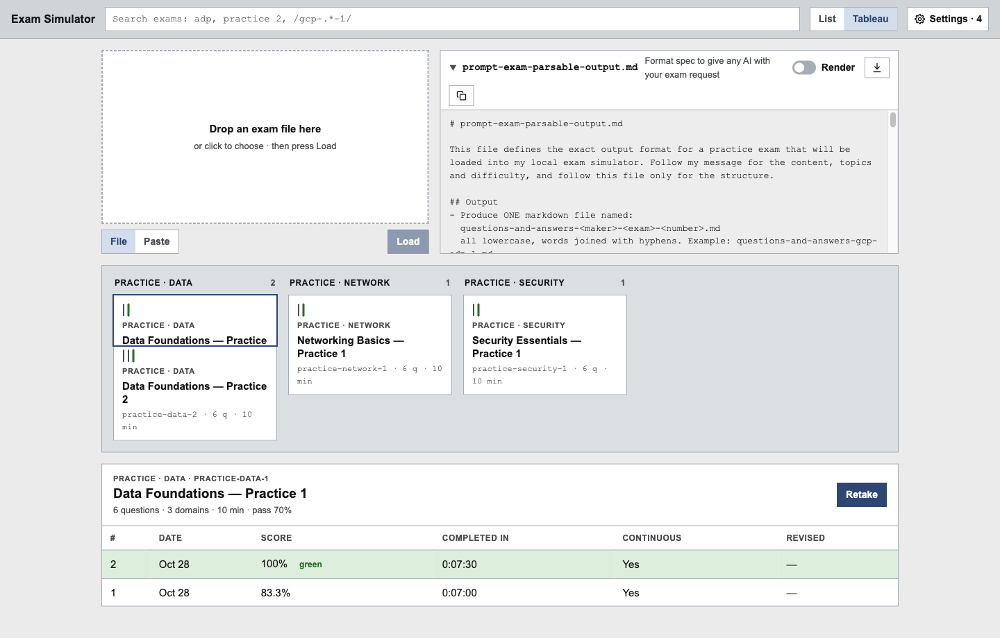
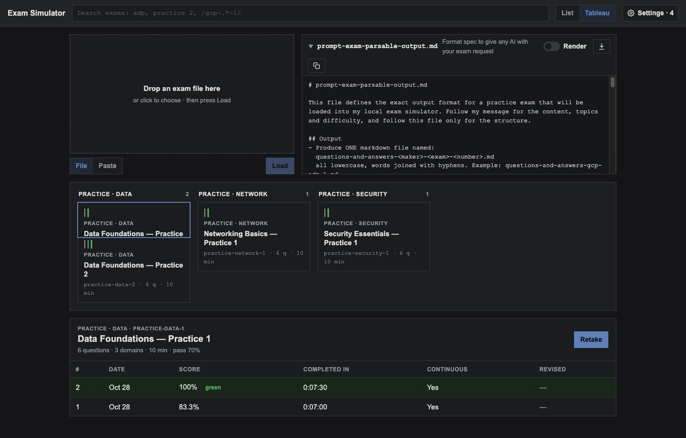

# Localhost Exam Simulator: The four layers


<p align="center"><a href="https://faisaltariq-dev.github.io/localhost-exam-simulator/">Interactive tour: the four layers, live mocks of every screen, and the build history</a></p>

A web-based exam simulator that runs on your own machine. It parses model-agnostic input, so any AI can write the exam from one prompt file, and turns it into a timed exam. Notes are built in, and you revise through as many attempts as you like. It has themes, and you can adjust each exam's time and pass score.

It also includes an optional, scalable workflow that lets lower-cost models fix exams that failed to parse. Every step is tracked, and nothing happens until you approve it. The agent never touches code. It only queues repair requests, which the app's own Python carries out once you approve them.

## Run

1-Clone and change directory
``` 
git clone https://github.com/faisaltariq-dev/localhost-exam-simulator && cd localhost-exam-simulator
```
2-Run the web app then in browser go to http://localhost:8000
``` 
python3 server.py
```
3- Finally open http://localhost:8000 It works offline and uses built in libraries so no external library installation needed!



## Use

1. **Get an exam.** Copy `prompt-exam-parsable-output.md` from the library and give it to any AI with your request, e.g. *"GCP ADP, extra hard, follow this prompt for the output structure."*
2. **Load it.** Drop the `.md` file or paste the reply, then press **Load**. If it's rejected, you see every reason at once.
3. **Take it.** Answer, bookmark questions, write a note per question and use the review list. The timer is green while time is left, then turns red and counts overtime. It never submits for you. **Pause** works, but warns you that real exams don't have one.
4. **Revise.** You get your score by domain, every explanation and your notes. Retakes start fresh. Tally marks count your attempts, and one turns green for your best clean pass: the highest score, at or above the pass mark, with no pause and no overtime.

## Repairs (optional)

When an exam won't load, you can send it to **Repairs**. Then point any coding agent at the folder: *"Read .FIXPARSE.MD in this folder and work through the Repairs inbox."*

- **It never needs to touch your code or your library.** The agent works only in `repairs/`. It reads a request, writes a `fixed.md`, and appends one line to `repairs/log.md`. The app's own Python (`store.py`) does the actual load, delete or reject, and only when you press the button in **Settings → Repairs**.
- **It works like network calls, simulated on disk.** `log.md` is an append-only request/response channel between you and the agent (sent → queued → approved or rejected), with notes both ways. Instead of locks, there is a simple conflict rule.
- **It's cheap to run.** It's a fixed agentic workflow, not an open-ended agent. There is one short instruction file, one folder per request, and formatting-only fixes, each checked with `python3 converter.py` before it is queued. It's written so that a small model can follow it.
- **It can be made cheaper.** Test different low-cost models on broken exams (`samples/broken/` is a start), evaluate the results, adjust `.FIXPARSE.MD`, and iterate.



## Project structure

```
localhost-exam-simulator/
├── run.txt                          # the one command that starts the app
├── server.py                        # local HTTP server + JSON API (127.0.0.1 only)
├── converter.py                     # strict parser/validator for exam markdown; also a CLI
├── store.py                         # storage, scoring, green-tally rule, Repairs queue + log
├── prompt-exam-parsable-output.md   # the format spec you give to any AI
├── .FIXPARSE.MD                     # the fixed workflow a Repairs agent follows
├── reproduciable-plan-prompt-for-localhostexamsimulatorparser.md   # the original design, frozen
├── web/                             # single-page app, vanilla JS, no build step
│   ├── index.html   style.css   favicon.svg
│   └── js/          app.js   api.js   util.js   library.js   exam.js   results.js   settings.js
├── samples/                         # example exams
│   └── broken/                      # one file per validation error
├── tests/                           # test_converter.py   test_rules.py   test_repairs.py
├── assets/                          # README images: the four layers + screenshots
├── exams/                           # your imported exams (gitignored)
├── data/                            # attempts + settings (gitignored)
└── repairs/                         # repair requests + log.md (gitignored)
```
> `exams/`, `data/` and `repairs/` aren't part of the repo. The app creates them the first time each one is needed.

## Themes

| Modern Light | Modern Dark |
| --- | --- |
|  |  |
| **Classic Light** | **Classic Dark** |
|  |  |